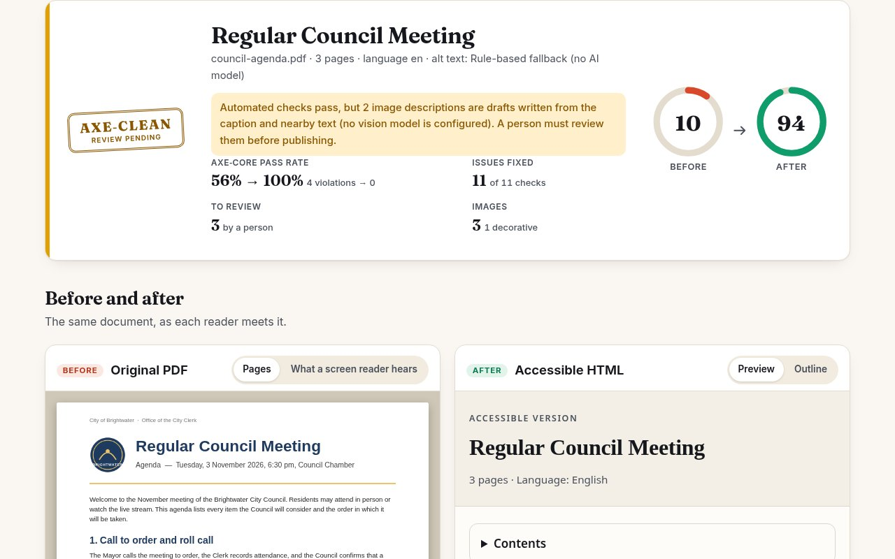

# AltPass

**Upload an inaccessible PDF. Get an accessibility audit and a fixed, screen-reader-friendly HTML version, with a before/after view and an axe-core proof.**



Most tools stop at *telling you* a PDF is inaccessible. AltPass rebuilds the document's real structure (language, title, headings, reading order, lists, tables, links, image alt text) as accessible HTML, scores the PDF and the HTML with the same weighted checklist, and runs [axe-core](https://github.com/dequelabs/axe-core) on the output, live in your browser.

Built for the Devpost [Build With AI: Basics](https://learn-ai-basics.devpost.com/) hackathon, using the Devpost Learn Skill Pack. The planning documents it produced are in the repo: [`scope.md`](scope.md), [`prd.md`](prd.md), [`spec.md`](spec.md), plus [`devpost/checklist.md`](devpost/checklist.md) and a code tour in [`devpost/app-map.html`](devpost/app-map.html).

## Why

The EU Accessibility Act has applied since 28 June 2025 (the harmonised standard EN 301 549 includes requirements for documents). The US ADA Title II web rule (28 CFR 35.200, WCAG 2.1 AA) has compliance dates of 26 April 2027 (populations of 50,000 or more) and 26 April 2028 (smaller entities and special districts). Most organisations still publish untagged PDFs: council agendas, slide decks exported to PDF, price lists. This is not legal advice.

## Run it

Needs Node.js 20 or newer. No API key is needed.

```bash
npm install
npm start            # http://127.0.0.1:3000
```

Open the page, drop a PDF or click one of the three deliberately inaccessible samples (`samples/`).

Command line:

```bash
npm run audit -- samples/council-agenda.pdf -o out.html --json out.json
```

Tests (unit, server, and browser tests; the browser tests need Chrome and are skipped without it, or set `CHROME_PATH`):

```bash
npm test
```

## What you see

- A verdict with the accessibility score before and after, and the axe-core pass rate.
- The original PDF pages next to the accessible HTML preview, with a simulated "what a screen reader hears" transcript of the original and a heading/landmark outline of the result.
- A live axe-core run in your browser (including colour contrast) on both the accessible output and a naive PDF-to-HTML export, for comparison.
- A checklist of 12 weighted checks, each mapped to a WCAG success criterion, and what still needs a person.
- An alt-text review list: edit a description, save, and the preview and score update.
- Downloads: the accessible HTML and a JSON audit report.

## Alt text: be clear about what is real

Alt text comes from a pluggable adapter (`src/alt/`):

| Adapter | When | What it does |
| --- | --- | --- |
| `rules` (default) | no key set | Drafts a description from the caption, the nearby heading and image statistics. **It does not look at the pixels.** Every draft is flagged for human review. |
| `openai` | `OPENAI_API_KEY` | Sends the image to an OpenAI-compatible chat-completions endpoint (`OPENAI_BASE_URL` for other servers). |
| `anthropic` | `ANTHROPIC_API_KEY` | Sends the image to the Anthropic Messages API. |

If a model call fails, that image falls back to the rules adapter and is flagged. The two model adapters are tested against a local mock server only; they have **not** been run against a live provider in this repository's build environment. See [`.env.example`](.env.example) for the settings (model defaults are guesses; set `ALTPASS_VISION_MODEL` to a vision model your account can use).

## How it works

```
PDF ─ src/extract.js (pdf.js: text with positions, images, links)
    ─ src/structure.js (columns, headings, lists, tables, header/footer removal)
    ─ src/alt/*        (alt text via the adapter)
    ─ src/render.js    (semantic, accessible HTML)
    ─ src/audit.js     (12 weighted checks before/after) + src/axe.js (axe-core in jsdom)
    ─ src/server.js    (Express API)  ─ public/ (the web UI, vanilla JS)
```

## Limits

- Structure is **inferred** from layout (font size and weight, gutters, alignment). Always skim the outline.
- Alt text is a draft unless a vision model is configured and you reviewed it.
- axe-core only finds what a machine can detect. A clean run is necessary, not sufficient, and AltPass output is not a compliance certificate.
- No OCR: scanned PDFs without selectable text are rejected with a clear message. Forms, maths and complex tables are out of scope.
- Tables with very narrow column gutters, or merged cells, may be missed or flattened to paragraphs.
- Up to 15 MB and the first 30 pages of a PDF are processed.

## Privacy and security

The server binds to `127.0.0.1` by default and keeps results in memory for one hour. With no key configured, nothing leaves your machine. The app sends a strict Content Security Policy; converted documents are served with `default-src 'none'` and rendered in a sandboxed iframe; all text is HTML-escaped by the renderer (covered by tests).

## Demo video

`node demo/record.js` re-records `demo/altpass-demo.mp4` (about 100 seconds, captions only) by driving the real app with Playwright and transcoding with ffmpeg.

## Licence and credits

MIT, see [`LICENSE`](LICENSE). Uses pdf.js (Apache-2.0), axe-core (MPL-2.0), Express, multer, jsdom, pngjs; fonts Inter and Fraunces (SIL OFL) via Fontsource. The sample PDFs and their images are generated by the scripts in `scripts/`.
